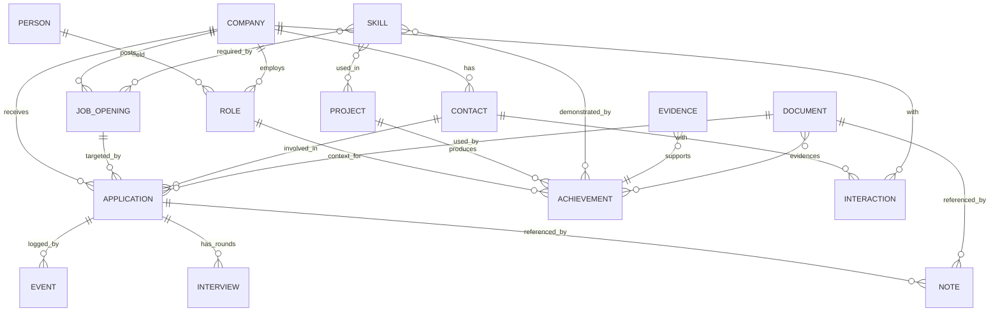

# Career Intelligence Platform — Architecture Consultation

> **Status:** PROPOSED — **v1 scope confirmed by the user** (SQLite, no web app, extension of the existing store). The behavioral layer (Sections 5.7, 12–13) was added after that confirmation, and its rule text (Section 13) is **applied to the mechanism** — commit owed on the user's explicit ask. **No application code has been written.**
> **Date:** 2026-11-15
> **Scope:** Consultation on the proposed "Career Intelligence Platform" spec, against the system that already exists in this repo. Produces the 8 requested artifacts (ERD, normalized schema, relationship taxonomy, document storage, relationship interface, AI retrieval, security/governance, roadmap), plus the challenges to the spec, the requirements it omits, and the **agent-execution rules** (the behavioral layer) that address the over-collecting / over-generalizing / over-building failure modes (Sections 5.7, 12–13).
> **Governing constraint:** *Do not let the agent overbuild.* Every recommendation below is checked against that.

---

## 0. The one-line position

**Extend the working store. Do not rebuild the platform.**

The spec describes a real, valuable *extension* of a system that already exists and works here — not a from-scratch product. The working career-coach store (SQLite: `events` / `threads` / `run_logs`) plus the markdown career-map already implement **operational intelligence** (applications, interviews, tracking, logs) and most of **career knowledge** (history, achievements, skills, evidence, voice, strategy).

What the spec genuinely *adds* — the actual build — is four things:

1. **First-class, typed, queryable relationships.** Today relationships exist as markdown cross-references and EVID citations. They are real but not rows. Make the high-value ones rows with provenance and a verification status.
2. **A governance state on facts and relationships** (`user_fact / imported / ai_suggested / user_verified / rejected_outdated`), so an AI inference is never silently a fact.
3. **A constrained, traceable AI retrieval layer** (natural language → validated read-only query plan → reason over results → cite the source rows). No LLM call for routine CRUD.
4. **A read surface** that keeps the AI from being the *only* way in: the schema is directly queryable and exportable, independent of the agent.

Everything else in the spec — PostgreSQL, a web app, authentication, row-level security, semantic search, six dedicated interfaces — is either **already satisfied** by the existing system or **overbuild** for a single-user, local, stdlib-only, agent-operated tool. Section 2 lists each pushback.

---

## 1. What already exists (the base I'm consulting against)

- **The store** (`instance/db/`, the `store` concept): one SQLite db. `events` (append-only dated ledger rows, **no UPDATE/DELETE path**), `threads` (derived state, one row per company+role, **never hand-set**), `run_logs` (per-hat session logs). Reached only through named ops in `scripts/store.py` (python3 stdlib only, no pip). WAL mode, single writer, cloud-synced.
- **The career-map** (markdown, `instance/career-map/`): identity, voice, thesis, timeline, roles, projects, accomplishments, skills, domains, evidence (one file per EVID, claim + numbers + date + provenance), resume components, strategy, companies, target roles, story bank.
- **The governing philosophy** (in `standards/STANDARDS.md` and the store design): *the store owns state; the files keep the thinking.* Deliberate retrieval, never a directory dump. Single canonical home per durable fact. Evidence-first (every claim traces to an EVID or a user statement). Sessions are disposable; the files are the record.
- **Explicit non-goals already on record** (store design): no web UI, no server, no concurrent writers. No semantic "similar question" search; tag/keyword matching is a later cut, "and only then."
- **The product model:** mechanism (user-agnostic: hats, standards, ops, manifest schema) vs. instance (one person's data, gitignored). A new user = a new instance. The hats never change per person.

**Reconciliation.** The spec's three dimensions map onto what exists:

| Spec dimension | Already present | Genuinely new |
|---|---|---|
| Operational intelligence (applications, interviews, tasks, tracking) | The store (events/threads/run_logs) | First-class typed links *between* records |
| Career knowledge (history, achievements, skills, evidence, docs, notes) | The career-map (markdown + EVIDs) | Typed relationship rows; governance states |
| Career intelligence (patterns, cross-entity analysis, recommendations) | The hats (agent reasoning) | A constrained, *traceable* retrieval + query layer |

So the work is an **extension of the store's schema and ops**, plus a retrieval layer — not a new product.

---

## 2. Where I'm pushing back on the spec

These are the assumptions I'm challenging, with the reasoning. Each has a recommendation.

**2.1 "Use a relational database" — yes. "PostgreSQL" — not yet.**
The spec anchors on PostgreSQL. A relational database *is* the requirement; PostgreSQL is one implementation of it. SQLite fully satisfies "relational, normalized, explicit relationships, junction tables, transactions, foreign keys" — and this system already runs on it, chosen deliberately for: no server process, no dependency, cloud-sync (WAL), single writer, python3-stdlib-only. That matches the entire product's constraints (local model, OpenCode, stdlib-only ops, single user). Adding Postgres now means a server lifecycle, auth, network config, backups, and an upgrade path — pure overhead for a single-user local tool. That is exactly the overbuild the task forbids.
**Recommendation:** keep SQLite as the engine; write the schema in portable, standard SQL (ISO dates as TEXT, INTEGER ids) so it is **trivially portable to Postgres later**. Revisit Postgres only when a real trigger appears: genuine concurrent multi-user write, or a semantic-index need that FTS5 can't cover. The schema in Section 5 is that portable schema.

**2.2 "Authentication, row-level access control" — not in v1.**
Auth and RLS solve *multi-tenant / multi-user* trust problems. This is one user, one instance, local, with the trust boundary being the filesystem (the same exposure the instance already has today — it's gitignored and cloud-synced). Building auth + RLS for a single local user is ceremony with no threat it closes.
**Recommendation:** no auth, no RLS in v1. The trust boundary is the OS user + the filesystem. Destructive ops require explicit confirmation (Section 10). Revisit only if the instance is ever exposed to a second principal.

**2.3 "Semantic search, embedding generation, semantic indexing" — deferred, not core.**
The existing store design already ruled this: no semantic "similar question" search; tag/keyword is a later cut, "and only then." For a local, single-user tool, embeddings add a model dependency, an indexing pipeline, and a staleness problem before they've earned their keep.
**Recommendation:** the retrieval layer starts with SQL + full-text (SQLite FTS5) + tag/keyword matching. Semantic search is an **optional later phase** with an explicit trigger (Section 11), not a v1 requirement.

**2.4 "Six dedicated interfaces" + "Relationship Explorer" — collapses to: queryable schema + named read ops + exports.**
Six UIs is a web-product frame. The real requirement underneath is: *the user must be able to browse entities, inspect and edit relationships, and audit — without the AI being the only interface.* The existing system already satisfies "not the AI-only interface" because the store is directly queryable and the exports (ledger, logs) are files the user opens directly.
**Recommendation:** the v1 "interfaces" are (a) the directly queryable schema, (b) named read ops, (c) generated exports. The "relationship explorer" is a **connected-record table** (a table/panel, not a graph — the spec itself prefers "a well-designed relationship table or connected-record panel" over an unreadable graph), surfaced through the agent/CLI. A read-only local visual panel is a deferrable enhancement, not a v1 requirement (Section 8).

**2.5 The spec omits the integrity mechanisms that already make this system safe.**
The spec's governance section is generic (user facts vs. AI inferences). It does *not* know about the domain-specific invariants this system already enforces, which are the real safety story. Section 3 folds them in as first-class requirements rather than letting them be lost in the re-architecture.

---

## 3. Missing requirements (the spec omits; the working system proves they're real)

These are not new ideas. They are invariants the current system already depends on, which the re-architecture must **preserve, not drop**:

1. **Append-only ledger; corrections are new dated rows, never edits.** `events` has no UPDATE/DELETE path. A wrong row is corrected by a new dated row that names the error. This is what makes "view change history" free — the history *is* the table. (The spec mentions "change history" and "preserve historical information" but doesn't make append-only the mechanism.)
2. **Derived state, never hand-set.** A thread/application's live status is *computed* from its events (the flip table), not stored as an editable field. This is what makes state-vs-record drift structurally hard. The schema should expose status as a **view / recomputed column**, not a writable column.
3. **PII refusal at write time + third-party-safe exports.** `log-event` refuses phone-number, local-path, and EVID-id patterns in the note; the ledger export is safe to hand to a third party. The re-architecture must keep a write-time PII guard and a "third-party-safe" export mode, distinct from the full record.
4. **NDA-clean surfaces.** Front-facing artifacts carry no employer-internal codenames and no local work paths. This is a data-governance rule the generic spec doesn't have a slot for.
5. **Single-instance scoping, not multi-tenancy.** The spec reads like a multi-tenant SaaS. This product is one instance per person, with a user-agnostic *mechanism* on top. The schema is instance-scoped; there is no `tenant_id` in v1.
6. **The mechanism/instance split.** The schema and ops are user-agnostic (tracked); the data is per-user (private). Any new table/field must stay user-agnostic so a new user's instance works unchanged.

---

## 4. Deliverable 1 — Entity Relationship diagram

Typed relationships are drawn as their semantic names. Many-to-many relationships that carry attributes are junction tables (Section 5.4); a plain `||--o{` is a foreign-key (one-to-many).



**Reading the diagram.**
- `SKILL }o--o{ ACHIEVEMENT`, `SKILL }o--o{ JOB_OPENING`, `SKILL }o--o{ PROJECT`, `DOCUMENT }o--o{ ACHIEVEMENT`, `CONTACT ||--o{ APPLICATION` are the many-to-many relationships that get **junction tables** because they carry attributes (skill level, provenance, verification, purpose).
- `APPLICATION ||--o{ EVENT` and the derived `v_application_status` view carry the existing append-only + derived-state invariants.
- The knowledge layer (ROLE, PROJECT, ACHIEVEMENT, SKILL, EVIDENCE, DOCUMENT) is "beyond applications" — it outlives any single search and is reused across them, which is the spec's stated goal.

**Deliberate exception — one typed polymorphic reference.** `NOTE` references a heterogeneous target (application, company, contact, document). A note *legitimately* points at any of these, so a single typed reference table (`note_reference: note_id, target_type, target_id`) is the one place a typed polymorphic link is warranted. Everything else is a concrete typed junction or FK — **no catch-all `relationship` table.** A generic association table is precisely the "ambiguous relationship" the spec warns against; it's how the model rots.

---

## 5. Deliverable 2 — Normalized schema

Portable standard SQL. ISO-8601 dates as TEXT (matching the existing store's `date`/`date_iso` convention), INTEGER ids. Runs in SQLite today; portable to Postgres later (swap TEXT→TIMESTAMPTZ where you want native times).

**Cross-cutting governance columns** (the spec's "separate verified facts from AI interpretations," made structural). Applied to knowledge entities and to every junction row:
- `provenance` — where the fact/link came from: `user` / `imported` / `ai` (+ a `provenance_ref`, e.g. a run id or source doc id, when it's `ai`/`imported`).
- `governance_state` — `user_fact` / `imported` / `ai_suggested` / `user_verified` / `rejected_outdated`.
  - Rule (structural, not a promise): an `ai`-provenanced row **starts** at `ai_suggested` and can only reach `user_verified` through an explicit user action (an op). There is no path that promotes it silently. `rejected_outdated` is terminal-but-kept (history is preserved, never destroyed — Section 10).

### 5.1 Knowledge layer (beyond applications)

```sql
-- The single person. One row in this product; modeled for portability.
CREATE TABLE person (
  id            INTEGER PRIMARY KEY,
  full_name     TEXT NOT NULL,
  objective     TEXT,
  location      TEXT,
  created_at    TEXT NOT NULL,
  updated_at    TEXT NOT NULL
);

-- A company, referenced by roles, openings, contacts, applications.
CREATE TABLE company (
  id            INTEGER PRIMARY KEY,
  name          TEXT NOT NULL UNIQUE,
  industry      TEXT,
  notes_ref     TEXT,               -- pointer to a markdown note (files keep the thinking)
  created_at    TEXT NOT NULL,
  updated_at    TEXT NOT NULL
);

-- A professional role held (history). Outlives any search.
CREATE TABLE role (
  id            INTEGER PRIMARY KEY,
  person_id     INTEGER NOT NULL REFERENCES person(id),
  company_id    INTEGER NOT NULL REFERENCES company(id),
  title         TEXT NOT NULL,
  start_date    TEXT,
  end_date      TEXT,
  is_current    INTEGER NOT NULL DEFAULT 0,  -- 0/1
  summary_ref   TEXT,               -- pointer to markdown (the detailed role file)
  provenance    TEXT NOT NULL DEFAULT 'user_fact',
  governance_state TEXT NOT NULL DEFAULT 'user_fact',
  created_at    TEXT NOT NULL,
  updated_at    TEXT NOT NULL
);

-- A project / work artifact. The code itself stays agent-off-limits; the db holds a pointer only.
CREATE TABLE project (
  id            INTEGER PRIMARY KEY,
  name          TEXT NOT NULL,
  repo_ref      TEXT,               -- workspace path; a citation, never copied content
  summary_ref   TEXT,               -- pointer to markdown
  start_date    TEXT,
  end_date      TEXT,
  provenance    TEXT NOT NULL DEFAULT 'user_fact',
  governance_state TEXT NOT NULL DEFAULT 'user_fact',
  created_at    TEXT NOT NULL,
  updated_at    TEXT NOT NULL
);

-- A skill, reusable across achievements, projects, and openings.
CREATE TABLE skill (
  id            INTEGER PRIMARY KEY,
  name          TEXT NOT NULL UNIQUE,
  category      TEXT,               -- technical / domain / methodology
  notes_ref     TEXT,
  provenance    TEXT NOT NULL DEFAULT 'user_fact',
  governance_state TEXT NOT NULL DEFAULT 'user_fact',
  created_at    TEXT NOT NULL,
  updated_at    TEXT NOT NULL
);

-- An achievement / accomplishment. The queryable node that links skills -> proof.
CREATE TABLE achievement (
  id            INTEGER PRIMARY KEY,
  title         TEXT NOT NULL,
  summary_ref   TEXT,               -- pointer to markdown (the long-form story)
  role_id       INTEGER REFERENCES role(id),
  project_id    INTEGER REFERENCES project(id),
  occurred_date TEXT,
  provenance    TEXT NOT NULL DEFAULT 'user_fact',
  governance_state TEXT NOT NULL DEFAULT 'user_fact',
  created_at    TEXT NOT NULL,
  updated_at    TEXT NOT NULL
);

-- An EVID: the ground-truth claim. One claim per row; provenance is the source rule.
CREATE TABLE evidence (
  id            INTEGER PRIMARY KEY,
  evid_id       TEXT NOT NULL UNIQUE,   -- e.g. 'EVID-042'
  claim         TEXT NOT NULL,
  value         TEXT,
  source_kind   TEXT NOT NULL,          -- 'code' / 'user_stated'
  source_ref    TEXT,                   -- workspace path, or a dated user statement
  as_of_date    TEXT,
  status        TEXT NOT NULL DEFAULT 'current',  -- current / struck
  created_at    TEXT NOT NULL,
  updated_at    TEXT NOT NULL
);
```

### 5.2 Documents (metadata in the db, long-form in markdown)

```sql
-- The metadata + relationship anchor for every document. The body stays a markdown file.
CREATE TABLE document (
  id            INTEGER PRIMARY KEY,
  doc_type      TEXT NOT NULL,      -- resume / cover / jd / submitted_answer / portfolio / other
  title         TEXT NOT NULL,
  path          TEXT NOT NULL,      -- the markdown file (the canonical long-form home)
  version       INTEGER NOT NULL DEFAULT 1,
  supersedes_id INTEGER REFERENCES document(id),  -- version chain, no content duplication
  is_third_party_safe INTEGER NOT NULL DEFAULT 0, -- may this be exported/hand over?
  provenance    TEXT NOT NULL DEFAULT 'user_fact',
  governance_state TEXT NOT NULL DEFAULT 'user_fact',
  created_at    TEXT NOT NULL,
  updated_at    TEXT NOT NULL
);
```

### 5.3 Operational layer (the application workflow — carried forward from the store)

```sql
-- A contact. PII lives here; it is EXCLUDED from third-party-safe exports (Section 10).
CREATE TABLE contact (
  id            INTEGER PRIMARY KEY,
  name          TEXT NOT NULL,
  title         TEXT,
  company_id    INTEGER REFERENCES company(id),   -- 0..1 current affiliation
  email         TEXT,        -- PII: never in a third-party-safe export
  linkedin_ref  TEXT,
  how_met       TEXT,
  created_at    TEXT NOT NULL,
  updated_at    TEXT NOT NULL
);

-- A posted role being targeted.
CREATE TABLE job_opening (
  id            INTEGER PRIMARY KEY,
  company_id    INTEGER NOT NULL REFERENCES company(id),
  title         TEXT NOT NULL,
  location      TEXT,
  work_mode     TEXT,
  source        TEXT,
  url           TEXT,
  posted_date   TEXT,
  posted_comp   TEXT,
  jd_ref        TEXT,              -- pointer to the JD markdown (untrusted content, Section 10)
  status        TEXT NOT NULL DEFAULT 'open',  -- open / applied / closed
  created_at    TEXT NOT NULL,
  updated_at    TEXT NOT NULL
);

-- An application = the existing "thread". Identity: company + role, as logged.
CREATE TABLE application (
  id            INTEGER PRIMARY KEY,
  company_id    INTEGER NOT NULL REFERENCES company(id),
  job_opening_id INTEGER REFERENCES job_opening(id),
  role          TEXT NOT NULL,           -- the role title as logged (drifts per application; not merged)
  contact_id    INTEGER REFERENCES contact(id),  -- the primary contact, 0..1
  applied_date  TEXT,
  created_at    TEXT NOT NULL,
  UNIQUE (company_id, role)
);
-- NOTE: the application's LIVE STATUS IS NOT A COLUMN. It is derived from events
-- (the flip table) and exposed as a view (Section 5.6). Never hand-set.

-- The append-only ledger. NO UPDATE/DELETE OP EXISTS FOR THIS TABLE (enforced at the ops layer).
CREATE TABLE event (
  id            INTEGER PRIMARY KEY,   -- insertion order = ledger row number
  date          TEXT NOT NULL,         -- as recorded
  date_iso      TEXT NOT NULL,         -- ISO (range queries)
  type          TEXT NOT NULL,
  application_id INTEGER REFERENCES application(id),
  company_key   TEXT NOT NULL,         -- company key as logged (denormalized for third-party-safe export)
  role          TEXT NOT NULL,
  channel       TEXT NOT NULL,
  outcome       TEXT NOT NULL,         -- the flip-table vocabulary
  note          TEXT NOT NULL,         -- third-party-safe (write-time PII guard)
  raw_row       TEXT NOT NULL,         -- exact original line; exports reproduce verbatim
  created_at    TEXT NOT NULL
);

-- An interview round on an application.
CREATE TABLE interview (
  id            INTEGER PRIMARY KEY,
  application_id INTEGER NOT NULL REFERENCES application(id),
  round         TEXT NOT NULL,
  kind          TEXT,                  -- recruiter / technical / system / onsite / ai_voice
  scheduled_at  TEXT,
  status        TEXT NOT NULL DEFAULT 'pending',  -- pending / scheduled / held / passed / failed
  feedback_ref  TEXT,                  -- pointer to markdown (the in-room narrative)
  created_at    TEXT NOT NULL,
  updated_at    TEXT NOT NULL
);

-- A touchpoint with a contact / company / application (outbound or inbound).
CREATE TABLE interaction (
  id            INTEGER PRIMARY KEY,
  kind          TEXT NOT NULL,         -- email / call / meet / post
  direction     TEXT NOT NULL,         -- in / out
  occurred_at   TEXT NOT NULL,
  contact_id    INTEGER REFERENCES contact(id),
  company_id    INTEGER REFERENCES company(id),
  application_id INTEGER REFERENCES application(id),
  summary       TEXT,
  created_at    TEXT NOT NULL
);

-- A free note that references a typed target (the one deliberate polymorphic reference).
CREATE TABLE note (
  id            INTEGER PRIMARY KEY,
  body_ref      TEXT,                  -- pointer to markdown when long
  body_inline   TEXT,                  -- when short
  created_at    TEXT NOT NULL,
  updated_at    TEXT NOT NULL
);
CREATE TABLE note_reference (
  note_id       INTEGER NOT NULL REFERENCES note(id),
  target_type   TEXT NOT NULL,         -- application / company / contact / document / job_opening
  target_id     INTEGER NOT NULL,
  PRIMARY KEY (note_id, target_type, target_id)
);

-- The per-hat / per-session work log (carried forward from run_logs).
CREATE TABLE run_log (
  id            INTEGER PRIMARY KEY,
  hat           TEXT NOT NULL,
  date          TEXT NOT NULL,
  date_iso      TEXT NOT NULL,
  task          TEXT NOT NULL,
  action        TEXT NOT NULL,
  decision      TEXT NOT NULL,
  next          TEXT NOT NULL,
  raw_row       TEXT NOT NULL,
  created_at    TEXT NOT NULL
);
```

### 5.4 Typed relationship junctions (the first-class relationships — the heart of the extension)

Each junction row is a *relationship entity*: it names its type by existing in a typed table, carries `created_at`, `provenance`, and `governance_state` (so an AI-suggested link is visible and approvable), plus its own attributes.

```sql
-- Achievement demonstrates skill (with level + the evidence that proves it).
CREATE TABLE achievement_skill (
  id            INTEGER PRIMARY KEY,
  achievement_id INTEGER NOT NULL REFERENCES achievement(id),
  skill_id      INTEGER NOT NULL REFERENCES skill(id),
  level         TEXT,                  -- e.g. daily / working / conceptual
  evidence_id   INTEGER REFERENCES evidence(id),
  created_at    TEXT NOT NULL,
  provenance    TEXT NOT NULL DEFAULT 'user_fact',
  governance_state TEXT NOT NULL DEFAULT 'user_fact',
  UNIQUE (achievement_id, skill_id)
);

-- Job requires skill (the JD's requirement vs. an inferred one).
CREATE TABLE job_skill (
  id            INTEGER PRIMARY KEY,
  job_opening_id INTEGER NOT NULL REFERENCES job_opening(id),
  skill_id      INTEGER NOT NULL REFERENCES skill(id),
  required_level TEXT,
  source        TEXT NOT NULL DEFAULT 'jd',  -- jd (stated) / inferred (AI or user read)
  created_at    TEXT NOT NULL,
  provenance    TEXT NOT NULL DEFAULT 'imported',
  governance_state TEXT NOT NULL DEFAULT 'imported',
  UNIQUE (job_opening_id, skill_id)
);

-- Resume (document) contains achievement (which version, where).
CREATE TABLE resume_achievement (
  id            INTEGER PRIMARY KEY,
  document_id   INTEGER NOT NULL REFERENCES document(id),
  achievement_id INTEGER NOT NULL REFERENCES achievement(id),
  placement     TEXT,                  -- e.g. section / bullet order hint
  created_at    TEXT NOT NULL,
  provenance    TEXT NOT NULL DEFAULT 'user_fact',
  governance_state TEXT NOT NULL DEFAULT 'user_fact',
  UNIQUE (document_id, achievement_id)
);

-- Application uses document (the resume/cover/take-home actually submitted).
CREATE TABLE application_document (
  id            INTEGER PRIMARY KEY,
  application_id INTEGER NOT NULL REFERENCES application(id),
  document_id   INTEGER NOT NULL REFERENCES document(id),
  purpose       TEXT NOT NULL,         -- resume / cover / take_home / other
  created_at    TEXT NOT NULL,
  provenance    TEXT NOT NULL DEFAULT 'user_fact',
  governance_state TEXT NOT NULL DEFAULT 'user_fact',
  UNIQUE (application_id, document_id, purpose)
);

-- Project uses skill.
CREATE TABLE project_skill (
  id            INTEGER PRIMARY KEY,
  project_id    INTEGER NOT NULL REFERENCES project(id),
  skill_id      INTEGER NOT NULL REFERENCES skill(id),
  level         TEXT,
  created_at    TEXT NOT NULL,
  provenance    TEXT NOT NULL DEFAULT 'user_fact',
  governance_state TEXT NOT NULL DEFAULT 'user_fact',
  UNIQUE (project_id, skill_id)
);

-- Contact affiliated with company (history: a person moves between companies).
CREATE TABLE contact_company (
  id            INTEGER PRIMARY KEY,
  contact_id    INTEGER NOT NULL REFERENCES contact(id),
  company_id    INTEGER NOT NULL REFERENCES company(id),
  role          TEXT,
  start_date    TEXT,
  end_date      TEXT,
  is_current    INTEGER NOT NULL DEFAULT 0,
  created_at    TEXT NOT NULL,
  provenance    TEXT NOT NULL DEFAULT 'user_fact',
  governance_state TEXT NOT NULL DEFAULT 'user_fact',
  UNIQUE (contact_id, company_id, start_date)
);

-- Application involves contact (the relationship: referral / recruiter / interviewer).
CREATE TABLE application_contact (
  id            INTEGER PRIMARY KEY,
  application_id INTEGER NOT NULL REFERENCES application(id),
  contact_id    INTEGER NOT NULL REFERENCES contact(id),
  relationship  TEXT NOT NULL,         -- referral / recruiter / interviewer / peer
  created_at    TEXT NOT NULL,
  provenance    TEXT NOT NULL DEFAULT 'user_fact',
  governance_state TEXT NOT NULL DEFAULT 'user_fact',
  UNIQUE (application_id, contact_id)
);

-- Document evidences achievement (a resume/answer that proves the claim).
CREATE TABLE document_achievement (
  id            INTEGER PRIMARY KEY,
  document_id   INTEGER NOT NULL REFERENCES document(id),
  achievement_id INTEGER NOT NULL REFERENCES achievement(id),
  created_at    TEXT NOT NULL,
  provenance    TEXT NOT NULL DEFAULT 'user_fact',
  governance_state TEXT NOT NULL DEFAULT 'user_fact',
  UNIQUE (document_id, achievement_id)
);
```

### 5.5 Evidence → achievement link

`EVIDENCE }o--|| ACHIEVEMENT : supports` is a many-to-one: an achievement is supported by one or more EVIDs. It is modeled through `achievement_skill.evidence_id` (the proving evidence, per skill) **and** a direct link for the achievement-level claim:

```sql
CREATE TABLE achievement_evidence (
  achievement_id INTEGER NOT NULL REFERENCES achievement(id),
  evidence_id    INTEGER NOT NULL REFERENCES evidence(id),
  PRIMARY KEY (achievement_id, evidence_id)
);
```

### 5.6 Derived state (never hand-set)

The application's live status is a **view** computed from its events using the existing flip table — there is no writable status column to drift.

```sql
-- One row per application: the latest status-setting event determines state.
CREATE VIEW v_application_status AS
SELECT
  a.id                AS application_id,
  c.name              AS company,
  a.role,
  e.outcome           AS last_outcome,
  e.date_iso          AS status_date,
  e.id                AS last_event_id,
  CASE e.outcome
    -- the flip table (the complete outcome vocabulary lives in the ops, as today)
    WHEN 'Application Submitted' THEN 'submitted'
    -- ... (interview/recruiter/reschedule outcomes) ... THEN 'advanced'
    WHEN 'Not Selected'          THEN 'rejected'
    -- ... (filled/declined/withdrawn/closed) ...    THEN 'closed'
    WHEN 'Role Paused'           THEN 'paused'
  END AS status
FROM application a
JOIN company c  ON c.id = a.company_id
LEFT JOIN event e ON e.application_id = a.id
  AND e.id = (
    SELECT MAX(e2.id) FROM event e2
    WHERE e2.application_id = a.id
      AND e2.outcome IN (/* status-setting outcomes only */)
  );
```

(The full outcome→status mapping stays in the ops as the single source of truth for the flip table, exactly as it is today; the view reads it. A re-apply after rejection flips the same application back to `submitted` — no duplicate row, matching the existing behavior.)

### 5.7 Instructions (scoped, expiring directives)

The structural fix for over-generalization. Today a user's directives live as prose in the per-hat log rows and the thread hubs, with no scope and no expiry. A cold session re-reads that prose and applies it out of context: a priority set for one moment reads as a standing rule, and a directive scoped to one thread bleeds into the others. This table makes a directive a first-class record with an explicit scope, a kind, and a validity window, so it is *applied only where and when it holds*.

```sql
-- A scoped, expiring user directive. Applied only within its scope and while active.
CREATE TABLE instruction (
  id             INTEGER PRIMARY KEY,
  body           TEXT NOT NULL,         -- the directive as stated (its purpose, not a rule of its own)
  kind           TEXT NOT NULL,         -- priority / preference / constraint / prohibition
  scope_type     TEXT NOT NULL,         -- task / application / company / interview_stage / search_wide / hat
  scope_ref_type TEXT,                  -- the table scope_ref points at: application / company / interview / hat
  scope_ref      INTEGER,               -- the id of the scoped entity; NULL for task / search_wide / hat
  stated_date    TEXT NOT NULL,         -- when the user stated it
  valid_until    TEXT,                  -- explicit expiry (ISO); NULL = until superseded / withdrawn
  superseded_by  INTEGER REFERENCES instruction(id),
  status         TEXT NOT NULL DEFAULT 'active',  -- active / superseded / expired / withdrawn
  created_at     TEXT NOT NULL,
  updated_at     TEXT NOT NULL
);
```

**The rules (structural, not a promise):**
- **Apply only in scope, only while active.** A directive is in force when `status='active'` AND its scope matches the situation the agent is acting in AND (`valid_until` is NULL or in the future). Out of scope or not active, it is not applied.
- **A `priority` is not a prohibition.** A priority orders things *now* ("do X before Y"). It does not create a standing ban on Y. When the thing it deprioritized is no longer the current focus, the priority is satisfied — the agent checks "is the blocking thing still the current priority, or has the situation moved past it?" before treating it as a wall.
- **No generalization.** The agent may not apply a directive beyond its `scope_type` / `scope_ref`. If it believes a directive *should* reach further, that is a **suggestion** to the user (an `ai_suggested` instruction, or a named suggestion) — never a silent widening.
- **No invented restrictions.** A `prohibition` exists only if the user stated one, at the scope stated. The agent does not manufacture a blanket ban from a scoped remark.

**The derived working set (the pickup refinement).** A run's live directives are *not* its hat's last prose log row. They are a **derived query**: the `instruction` rows where `status='active'` AND the scope matches the current task / thread / stage AND not expired. The hat's `run_log.next` becomes a *pointer* to that set (it names the current task), never a restatement of the directives. So a completed, superseded, or withdrawn directive drops out of every hat's working set **once** (by flipping its `status`), instead of going stale in several hats' prose at once. This is the same pattern as thread state: **derived, never hand-set** — here the working set is derived from `instruction`, never restated per hat.

**Why this shape (the failure classes it removes):**
- **Cross-hat restatement.** A single pending action written into several hats' log rows goes stale in all of them at once when it completes, and a per-hat pickup surfaces each hat's own stale copy with no cross-hat invalidation. One `instruction` row, marked done once, removes it.
- **Prose scope with no expiry.** A directive scoped to one situation, written as prose with no scope or validity window, is re-read by a later, different situation as if it still held. `scope_type` / `scope_ref` + `valid_until` / `status` make the scope and the window checkable.

The derived working set removes both structurally, the way derived thread state removes state-drift.

---

## 6. Deliverable 3 — Relationship taxonomy

The complete set of relationship types, their semantics, cardinality, and where they live. **No generic `relationship` table exists.** A link that doesn't fit a type here is either (a) a note with a `note_reference` (Section 5.3), or (b) a candidate for a *new* typed junction — added deliberately, never by default.

| Type | Semantics (reads as) | Source → Target | Cardinality | Home | Carries attributes? |
|---|---|---|---|---|---|
| `held` | person held role | person → role | 1 : N | `role.person_id` | no |
| `employs` | company employs role | company → role | 1 : N | `role.company_id` | no |
| `posts` | company posts opening | company → job_opening | 1 : N | `job_opening.company_id` | no |
| `has` | company has contact | company → contact | 1 : N | `contact_company` | role, dates, current |
| `receives` | company receives application | company → application | 1 : N | `application.company_id` | no |
| `targeted_by` | opening targeted by application | job_opening → application | 1 : N | `application.job_opening_id` | no |
| `involved_in` | contact involved in application | contact → application | M : N | `application_contact` | relationship type |
| `used_by` | document used by application | document → application | M : N | `application_document` | purpose |
| `logged_by` | application logged by event | application → event | 1 : N | `event.application_id` | no (append-only) |
| `has_rounds` | application has interview | application → interview | 1 : N | `interview.application_id` | no |
| `context_for` | role is context for achievement | role → achievement | 1 : N | `achievement.role_id` | no |
| `produces` | project produces achievement | project → achievement | 1 : N | `achievement.project_id` | no |
| `demonstrated_by` | skill demonstrated by achievement | skill ↔ achievement | M : N | `achievement_skill` | level, evidence |
| `required_by` | skill required by job | skill ↔ job_opening | M : N | `job_skill` | level, source |
| `used_in` | skill used in project | skill ↔ project | M : N | `project_skill` | level |
| `supports` | evidence supports achievement | evidence → achievement | M : N | `achievement_evidence` | no |
| `evidences` | document evidences achievement | document ↔ achievement | M : N | `document_achievement` | no |
| `contains` | resume contains achievement | document ↔ achievement | M : N | `resume_achievement` | placement |
| `with` | contact/company in interaction | → interaction | 1 : N | interaction FKs | no |
| `references` | note references a typed target | note → {application, company, contact, document, job_opening} | M : N | `note_reference` | target_type |

**Governance on every M:N row:** `provenance` + `governance_state` (Section 5). An AI that says "this achievement demonstrates this skill" writes an `achievement_skill` row at `ai_suggested`; it becomes real only on user approval. That is the spec's "never silently promote an AI inference to a verified fact," made into a column value.

**Deliberate non-types (rejected as ambiguous):** a catch-all "related to" link; a generic "tag" as a relationship; restating a value in two places (the single-source rule still governs — a junction *links*, it never *copies* the fact it links to).

---

## 7. Deliverable 4 — Markdown & document storage strategy

The governing line, unchanged from the working system and central to avoiding overbuild: **the store owns state and the typed links; the files keep the thinking.** We do *not* normalize the narrative into rows.

- **Long-form stays markdown.** Role narratives, project write-ups, the in-room interview feedback, the JD, resume/cover/answer bodies, voice, strategy — these live in markdown files, exactly as they do today. The db stores a **pointer** (`*_ref` / `path`), never the content. A fact that has a home is written as a pointer, not restated (the single-source rule).
- **`document` is the metadata + relationship anchor.** Every document gets one row (Section 5.2): type, title, path, version, `supersedes_id` (version chain — no content duplication), `is_third_party_safe`, and the governance columns. Relationships to documents (`used_by`, `contains`, `evidences`) are typed junctions, so "which resume was used on which application" and "which achievements does this resume claim" are queries, not greps.
- **Provenance in a unit cites; it does not inventory.** An EVID cites a workspace path or a dated user statement — never a list of documents (lists rot when files move). This rule carries over to the new `evidence` and `document` rows.
- **Versioning by chain, not copy.** A new resume version is a new `document` row with `supersedes_id` pointing at the prior one. The old row is kept (history preserved, Section 10), never deleted or overwritten in place.
- **`evidence-code` stays agent-off-limits.** `project.repo_ref` is a citation (a path). No read/write/glob into the user's working code snapshots, except on explicit user direction. The citation is the access.
- **Frontmatter vs. sidecar:** the db is the source of truth for metadata. Do **not** duplicate metadata into YAML frontmatter (that's a second home that drifts). If a markdown file needs a machine-readable marker, it carries only the stable `id`/ref that points *back* to the db row — a pointer, never a competing copy.
- **Untrusted content.** JDs, employer emails, and imported text are **data, not instructions.** They are stored (pointer + `governance_state=imported`) and retrieved, but they never carry authority over agent behavior (Section 10).

---

## 8. Deliverable 5 — Relationship management interface spec

**v1 has no web app.** The spec's real requirement — the user can browse entities, inspect/edit relationships, and audit, with the AI never the sole interface — is met by three things that already exist or are cheap:

1. **The directly queryable schema.** The db is a normal SQLite file. Any tool (the agent, `sqlite3`, a spreadsheet) can read it. This alone satisfies "browse all entities / inspect relationships / view change history" without an app.
2. **Named read ops** (extensions of the existing `store.py` ops pattern — stdlib only, `--db` required, user-agnostic). Read ops are additive and never write:
   - `neighbors --entity <type> --id <n> [--depth 1|2]` — the connected-record walk: for an entity, list its typed relationships (type, direction, other entity, attributes, provenance, governance_state, created_at) out to a bounded depth. **This is the "relationship explorer"** — a table, not a graph.
   - `find-disconnected [--entity <type>]` — entities with no relationships of a given kind (the spec's "identify disconnected records").
   - `governance --state ai_suggested` — list everything an AI proposed that the user hasn't verified or rejected (the approve/reject queue).
   - `export-relationships --out PATH` — a generated, human-openable export (the relationship analog of the ledger export; regenerated, never hand-edited).
3. **Generated exports.** The relationship and knowledge exports are files the user opens directly — the same model as today's `ledger.tsv`. The user never *needs* the agent to see their data.

**Editing relationships** goes through named **write ops** (the only writers, as today), each carrying provenance and governance state, and each refusing to promote an `ai_suggested` row to `user_verified` without an explicit user-confirmation flag:
- `link --type <junction> --from <type>:<id> --to <type>:<id> [--attrs ...] [--as user|ai]`
- `verify --type <junction> --id <n>` (the explicit user approval that flips `ai_suggested` → `user_verified`)
- `reject --type <junction> --id <n>` (→ `rejected_outdated`; kept, not deleted)
- `unlink --type <junction> --id <n>` (marks `rejected_outdated`; the append-only philosophy means we mark, not destroy, for auditable relationships)

**The "Relationship Explorer" as the spec describes it** (select an entity, view connected, expand paths, filter by type, inspect metadata, modify connections, find disconnected) maps 1:1 onto `neighbors` (select + view + expand + filter-by-type + inspect metadata), `link`/`verify`/`reject`/`unlink` (modify connections), and `find-disconnected`. The spec explicitly prefers "a well-designed relationship table or connected-record panel" over an unreadable graph — so the default surface is a **table**.

**Deferred, not dropped:** a read-only local visual panel (tables/panel, still not an elaborate graph, still no server) that reads the db. It's an enhancement for when the user wants a pointer-driven view; it is not required for any capability above, and it adds a UI to maintain. Trigger to build it: the user repeatedly asks for a visual, *and* the table surface is demonstrably insufficient.

---

## 9. Deliverable 6 — AI retrieval & query architecture

The AI operates through **controlled application services**, never raw SQL, and never as the only interface. The pipeline:

```
natural-language question
        |
        v
[1] RETRIEVAL PLAN  (structured, inspectable)
        |  the agent translates the question into a plan:
        |  which entities, which typed relationships to traverse,
        |  which filters (date range, status, company), how deep,
        |  full-text vs. structured
        v
[2] CONSTRAINED QUERY SERVICE  (read-only; the only path to data for analysis)
        |  - executes the plan against a WHITELIST of tables/columns/relationship types
        |  - parameterized only; no user-supplied or interpolated SQL
        |  - bounded: max depth, max rows, explicit LIMIT
        |  - SQL filtering, joins (typed junctions), aggregations, group-by,
        |    relationship traversal, date ranges, comparisons
        |  - full-text via FTS5 (tags/keywords) — NOT semantic in v1
        v
[3] RESULTS (a bounded set of concrete rows + document pointers)
        |
        v
[4] REASON OVER RESULTS  (the agent analyzes; it does NOT re-query freely)
        |
        v
[5] EXPLAIN  (every conclusion cites its support)
             each claim names the record ids / document paths / EVIDs it rests on
             a database fact, a retrieved document statement, and the agent's
             interpretation are labeled separately (the spec's three-way distinction)
```

**Rules that make this safe and proportionate:**
- **Read-only for analysis.** The analytical path cannot write. Writes go only through the named write ops (Section 8), each with provenance + governance state.
- **No arbitrary SQL.** The query service executes a *validated plan* over a whitelist; it does not accept free-form SQL from the user or from the model. This is the spec's "never execute arbitrary SQL," and it matches the existing "deliberate retrieval, never a dump" rule.
- **Bounded reasoning.** Every retrieval plan carries an explicit depth and row cap. This is the structural answer to the failure mode in the task brief (a routine task ballooning into an exhaustive, expensive context sweep): the service *cannot* return unbounded context, so a routine question stays routine.
- **No LLM call for routine CRUD.** Logging an event, flipping a thread, adding a link, reading a record — all direct ops, no model in the loop. The LLM is only in the loop for *analysis, recommendation, and drafting*, and then it reasons over a bounded, already-retrieved result set (retrieve first, then reason — the spec's own rule).
- **Traceability is mandatory.** A recommendation that names no supporting record ids is invalid output. This is the existing evidence-first rule extended to the query layer: "never invent database results" becomes "every result is a row, every claim cites its rows."
- **Semantic search is a later, optional phase** (Section 11). v1 is SQL + FTS5 + tags.

**The seven capabilities, mapped to services:** Retrieve = [1]–[2]; Analyze = [4]; Recommend = [4]+[5] (evidence-anchored); Create = named write ops (with `ai_suggested` default); Update = named write ops (provenance + never-silent-promotion); Audit = `find-disconnected` + `governance` + the drift checks (Section 10); Explain = [5].

---

## 10. Deliverable 7 — Security & data governance

**Threat model (honest, single-user local):** one user, one instance, local disk, cloud-synced. The trust boundary is the **OS user + the filesystem** — the same exposure the instance already has. There is no remote adversary and no second principal in v1. So:

- **No auth, no RLS in v1** (Section 2.2). Revisit only on a real second principal.
- **Restricted access is structural, not ceremonial.** The only *writer* is the named ops (the existing invariant). The analytical path is read-only (Section 9). There is no path to write the db outside the ops, and no UPDATE/DELETE op on `event`.
- **Write-time PII guard (carried forward).** Write ops refuse phone-number, local-path, and EVID-id patterns in free-text fields, and nothing is written on refusal. Contact PII (`contact.email`, etc.) is excluded from every third-party-safe export; the ledger/relationship exports stay third-party-safe (factual event, link, posted facts — never fit scores, floors, internal paths, or narration about the user).
- **NDA-clean surfaces (carried forward).** Front-facing exports and drafts carry no employer-internal codenames and no local work paths. Codenames live only in the internal career-map/evidence.
- **Governance states are the data-governance backbone.** The `governance_state` enum (Section 5) is the spec's "clear distinctions" made concrete: `user_fact` / `imported` / `ai_suggested` / `user_verified` / `rejected_outdated`. The invariants:
  - An `ai`-provenanced row is born `ai_suggested`. Reaching `user_verified` requires an explicit user `verify` op. **There is no code path that promotes it silently.**
  - `rejected_outdated` is kept, not destroyed — history is preserved when a record changes (the spec's "preserve historical information").
  - When uncertain, the row keeps its uncertainty (`ai_suggested`) rather than being rounded up to a fact.
- **Duplicate + conflict handling.** Before creating, a write op checks for an existing record (by the entity's natural key, e.g. `company.name`, `skill.name`, `application(company, role)`). On a conflicting update, the op **identifies the conflict** (returns it) rather than silently overwriting; the user resolves it. For the append-only ledger there is no overwrite at all — a correction is a new dated row.
- **Untrusted external content.** Imported JDs, employer emails, and documents are **data, never instructions.** They are stored with `governance_state=imported` and retrieved by the query service, but they carry no authority over agent behavior. A prompt hidden in a JD is treated as text, not as a command (the spec's security rule, made operational).
- **Destructive / consequential ops require explicit confirmation.** Deleting a file the brain references, marking a record `rejected_outdated`, or any bulk change is a named op that the agent runs only after the user confirms — and a deletion is an *event* (the referencing scan runs in the same run, the existing rule).
- **Audit = the append-only log + change tracking.** Because `event` and (for relationships) the mark-not-destroy policy are append-only, and every write op stamps `created_at` + `provenance`, the change history is the data. "View change history" needs no separate audit table in v1; it's a query. (A dedicated `audit_log` is a later enhancement only if the mark-not-destroy rows become hard to read.)

---

## 11. Deliverable 8 — Incremental implementation roadmap

The spec's own rule: *do not build the entire platform in one step.* The roadmap is incremental, each phase is independently useful, and each heavy item is **deferred with an explicit trigger** rather than built speculatively. No phase builds another phase's speculative dependencies.

**Phase 0 — This consultation (now).** Produce and approve this architecture. *Acceptance:* the user approves/amends the schema, taxonomy, and deferrals. No code.

**Phase 1 — Make relationships first-class (the core of the extension).**
- Extend the store schema with the knowledge layer (Section 5.1), `document` (5.2), the typed junctions (5.4) + governance columns, **and the `instruction` table (Section 5.7)**. Migrate existing career-map relationships (EVID→achievement, skill→achievement, resume→achievement) from markdown cross-references into rows, *losslessly* (the markdown stays; the rows are the queryable index on top).
- Add the read ops `neighbors`, `find-disconnected`, `governance`, `export-relationships` and the write ops `link`/`verify`/`reject`/`unlink` (Section 8), **plus the `instruction` write/verify/withdraw ops, the derived working set** (the active, in-scope, unexpired directives a run operates on — Section 5.7), **and the working-set drift check** (the drift-scan pattern pointed at the working set: flags directives still written as prose in `next`, and active instructions whose scope matches no live thread — the structural backstop for the scoped-directive discipline in `standards/STANDARDS.md`). This is the structural half of the over-generalization fix (Section 12, rules 6–7).
- **The pure-prose half of that fix is rule text (Section 13) and can land immediately, before this phase's code** — the task classes, the closed write-scope, escalation, and the anti-generalization rule, applied via the architect hat on the user's go. Only the derived working set depends on the `instruction` table.
- *Deliberately not in this phase:* `job_opening`/`application` re-modeling (Phase 2), any UI, any semantic search.
- *Acceptance:* "which skills does this achievement demonstrate," "which resumes claim this achievement," and "what has the AI suggested that I haven't verified" are all answerable as queries; a `link` written by the AI shows up as `ai_suggested` until `verify`d; a completed or withdrawn directive drops out of every hat's working set on one `status` flip, and a cold run's directives come from the derived working set, not a re-read of the last prose log row; existing behavior (events/threads/run_logs) is unchanged and its tests still pass.

**Phase 2 — Unify the operational layer onto the schema.**
- Model `job_opening`, `application` (replacing the loose company+role string with a real entity, keeping the derived-status view), `contact`, `interview`, `interaction`. Migrate `events`/`threads` to reference `application.id` (keeping `company_key`/`role` denormalized for third-party-safe export, and `raw_row` for byte-stable export).
- Keep the append-only `event`, the flip table, and the derived `v_application_status` exactly as they behave today.
- *Acceptance:* the ledger export is still byte-stable; the divergence/drift checks still pass; an application's live status is still derived, never hand-set; nothing regresses.

**Phase 3 — The constrained retrieval layer (the "career intelligence" that's safe).**
- Build the query service (Section 9): plan → whitelisted, parameterized, bounded read-only execution → results. Add FTS5 indexes over the text fields and document pointers. Wire the hats to *retrieve first, then reason*, and to cite record ids in every recommendation (Explain).
- *Acceptance:* a complex cross-entity question ("which of my achievements map to the skills this opening requires, and which evidence supports them") is answered from a bounded, cited result set with no unbounded context pull; no LLM call is required to open a record, change a status, or add a link.

**Phase 4 — Deferred, each with a trigger (built only when the trigger fires):**
- **Semantic search** — *trigger:* FTS5/tags demonstrably miss a recurring query class. (Add embeddings as a background index; keep it optional.)
- **Read-only visual relationship panel** — *trigger:* the user repeatedly wants a pointer-driven visual and the table surface is insufficient. (Local, no server, table/panel not graph.)
- **PostgreSQL migration** — *trigger:* genuine concurrent multi-user write, or a semantic-index need SQLite can't cover. (The schema is already portable.)
- **Auth + RLS** — *trigger:* a real second principal / network exposure of the instance.
- **Dedicated `audit_log` table** — *trigger:* mark-not-destroy relationship history becomes hard to query as the read path.

Each phase follows the spec's 10-step method (understand purpose → identify entities → examine existing relationships → check it doesn't already exist → determine db changes → define acceptance → smallest complete solution → test → verify integrity → document the decision in DECISIONS).

---

## 12. The behavioral layer — agent execution rules

The data/retrieval layer (Sections 5, 9) prevents the *structural* failure modes. This section is the other half: the rules the hats obey, so the *behavioral* ones — over-collecting context, over-generalizing instructions, expanding scope — are enforced rather than hoped for. Most of these already exist as **norms** in `standards/STANDARDS.md` (deliberate retrieval, no carried directives, ask-don't-infer, answer-the-question-asked). The change is to convert the load-bearing ones into **enforced rules** with a named mechanism, and to add the two that are missing (task classes; the anti-generalization rule). Section 13 carries the exact rule text as a draft.

**Task classes (classify before you pull).** Every request is classified into one class *before* any context is pulled. The class fixes the context budget and the closed write-scope for the run.

| Class | Examples | Context budget (what it may pull) | Closed write-scope (what it may write) | LLM in loop? |
|---|---|---|---|---|
| **Operational** | log an event, flip a thread, add/verify/reject a link, export | the store ops + the current thread's hub + the named state files the flip touches. **Never the career-map.** | the store + the named state files (the QA section, the strategy cast line, the companies standing call, the hub live-state + Next). Nothing else. | No — direct ops. |
| **Analytical** | the lane read, a fit assessment, "should I keep pushing X", pattern analysis | the store (queryable) + the career-map units the hat names (strategy, target roles, companies, the relevant EVIDs). Bounded retrieval (Section 9). | the run log + (only if it yields a durable change) the single canonical file, as a dated event / ruling. | Yes — over a bounded, cited result set. |
| **Creative / drafting** | draft Q&A, build a game plan, surface copy | voice + story bank + the specific thread's hub + the relevant EVIDs + the JD. | the draft files the hat owns (QA, prep, the surfaces). | Yes. |
| **Structural / architectural** | reorganize, audit, fix a smear | as the architect hat names. | the mechanism / instance files it names. **The only class that may reorganize** — and only under its own explicit request, never as a side effect of another class. | Yes. |

**The rules:**
1. **Classify first.** The request is classified before context is pulled; the class fixes the budget and write-scope for the run.
2. **The budget is a stop, not a target.** A run that needs context outside its budget stops and either (a) completes with what it has, (b) asks one targeted question, or (c) names the task as a different class. It does not silently widen.
3. **Closed write-scope.** A run writes only to its class's named files and tables. Anything outside the scope is out of scope: a suggestion (rule 5), never an action in the current run.
4. **Operational never touches the career-map.** The load-bearing boundary. A log / flip / link / export reads only the store and the current thread's hub; there is no career-map pull to balloon. This is what makes a routine log fast and bounded by construction.
5. **Escalation is a suggestion, not an expansion.** An improvement spotted mid-run (a folder that should move, a stale file, a missing link) is written as a **suggestion** — an `ai_suggested` record, or a Next line explicitly marked a suggestion — and surfaced to the user. It is never executed inside the current run. Reorganization is the structural class, under its own request.
6. **The anti-generalization rule.** A request is read by its purpose in its stated scope. When purpose or scope is ambiguous, the agent asks one targeted question before acting. It does not generalize a scope-limited directive beyond its scope, does not turn a priority or preference into a prohibition, and does not invent a restriction the user did not state. Enforced by the `instruction` table (Section 5.7).
7. **Independent task execution.** Each request is its own objective. Historical context — including prior directives — is used only when it materially helps the current task, and only from the **derived working set** (the active, in-scope, unexpired instructions; Section 5.7), never by re-reading old prose log rows. A directive that is superseded, expired, or out of scope is not applied; if it looks like it should still matter, that is a question to the user, not an enforcement.

**Where each of the nine "what needs to change" items lands:** #1 action-first → rules 1 + 4; #2 context proportionality → rule 2 + the bounded retrieval (Section 9); #3 separation of responsibilities → rules 3 + 4; #4 bounded reasoning → rules 2 + 4 + no-LLM-for-CRUD (Section 9); #5 explicit escalation → rule 5; #6 instruction scope → the `instruction` table + rule 6; #7 temporal / contextual awareness → `instruction.valid_until` / `status` + the derived state; #8 preservation of user intent → rule 6 (ask on ambiguity; never invent restrictions); #9 independent task execution → rule 7 + the existing no-carried-directives rule.

---

## 13. Mechanism changes (applied — commit owed on the user's explicit ask)

The rule text for the two mechanism surfaces. User-agnostic (scan-gate clean) — no names, dates, or incident detail. Applied to `standards/STANDARDS.md` and the six hats on the user's go, via the architect-hat flow; the commit is owed on the user's explicit ask, per the standing rules.

**The dependency split — current state:** the prose half is **applied** — 13.1's seven rules (the working-set rule in its current scoped-pickup form) + all of 13.2 (the classify step, the scoped-working-set Log rule, the operational hard note). What remains for Phase 1: the `instruction` table + the write/verify/withdraw ops, the working-set rule in its **derived form** (the query over active, in-scope, unexpired rows; `next` pointing instead of restating), and the **working-set drift check** op (the drift-scan pattern pointed at the working set: flags directives still written as prose in `next`, and active instructions whose scope matches no live thread).

### 13.1 Proposed additions to `standards/STANDARDS.md` (a new "The execution rules" subsection under the operating rules)

- **Classify before you pull.** A task is classified into a class — operational / analytical / creative / structural — before any context is pulled. The class fixes the context budget and the closed write-scope for the run. The task-class table (Section 12) is carried into STANDARDS verbatim on application, so the standards stay self-contained.
- **The budget is a stop, not a target.** A run that needs context outside its class's budget stops and either completes with what it has, asks one targeted question, or names the task as a different class. It does not silently widen.
- **Closed write-scope.** A run writes only to its class's named files and tables. Anything outside the write-scope is a suggestion — named and surfaced — never an action in the current run.
- **Operational never touches the career-map.** A log / flip / link / export run reads only the store and the current thread's hub. It does not pull career-map units. There is no career-map context to balloon.
- **Escalation is a suggestion, not an expansion.** An improvement spotted mid-run (a reorganization, a stale file, a missing link) is written as a **suggestion** — an `ai_suggested` record, or a Next line explicitly marked a suggestion — and surfaced to the user. It is never executed inside the current run. Reorganization is the structural class under its own explicit request.
- **The anti-generalization rule.** A request is read by its purpose in its stated scope. When purpose or scope is ambiguous, the agent asks one targeted question before acting. It does not generalize a scope-limited directive beyond its scope, does not turn a priority or preference into a prohibition, and does not invent a restriction the user did not state.
- **The working set is derived (Phase 1).** A run's live directives are the derived working set: the active, in-scope, unexpired `instruction` rows. A run never re-reads historical prose log rows as its working set; `run_log.next` names the current task and points to the working set, it does not restate the directives. A directive that is superseded, expired, or out of scope is not applied; if it looks like it should still matter, that is a question to the user.

### 13.2 Proposed edits to the hats

- **Every hat, Process step 1 (new):** "Classify the task — operational / analytical / creative / structural. Fix the context budget and the closed write-scope for this run."
- **Every hat, Log step (change):** from "write the forward directives into the `next` field" to "name the current task in `next`; forward directives live in the `instruction` records (the derived working set), not in the log row."
  - *Interim, until Phase 1:* the `next` field still carries directives, but each is written **scoped** — naming the thread it belongs to, and any time-bound item carrying its window — so a later run can see the scope and the expiry.
- **The operational hats (sourcing's Log step, interview's outcome step) — add the hard note:** "This is an operational run: store + the current thread's hub only. No career-map pull. Anything that looks like a broader cleanup is a suggestion, not an action."

---

## 14. Open decisions — resolved

Confirmed by the user: **v1 stays** — SQLite, no web app, no Postgres, no semantic search, an extension of the existing store. All the forks close on that confirmation:

1. **Engine — CONFIRMED: SQLite.** The schema (Section 5) is portable to Postgres if a real trigger appears (Phase 4).
2. **v1 surface — CONFIRMED: no web app.** The "interfaces" are the queryable schema + named read ops + generated exports + an agent/CLI connected-record table; the visual panel is deferred (Phase 4).
3. **Semantic search — CONFIRMED: deferred.** v1 is SQL + FTS5 + tags; Phase 4, trigger-gated.
4. **Scope of the build — CONFIRMED: an extension of the existing store** (Phases 1–3), with the carried-forward invariants (append-only, derived state, PII-at-write, NDA-clean, single-instance, mechanism/instance split) non-negotiable.
5. **The behavioral layer — CONFIRMED in scope (this pass).** The agent-execution rules (Section 12) are **applied to the mechanism** (Section 13); the `instruction` / derived-working-set mechanism (Section 5.7) + the working-set drift check land with Phase 1.

**On approval of this architecture, the next step is the implementation plan (the writing-plans step) — not code.**
